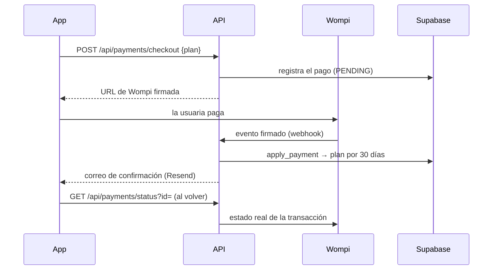

<div align="center">

# Chroma · API

### El motor de colorimetría, recomendaciones y pagos de Chroma


[Contexto](#contexto-y-objetivo) · [Qué hace](#qué-hace) · [Cómo funciona](#cómo-funciona) · [Endpoints](#endpoints) · [Empezar](#empezar) · [Pruebas](#pruebas) · [Supabase](#supabase) · [Documentación](#documentación-del-proyecto) · [Equipo](#equipo)

</div>

---

**Chroma** recomienda maquillaje según la colorimetría de cada persona: identifica su estación (12 estaciones), su subtono y su paleta, y calcula qué tan compatible es cada producto con ella. Este repositorio es la **API** que hace esos cálculos y cobra los planes. La app que la usa está en **[Chroma-App](https://github.com/nataliap2005/Chroma-App)**, donde también está la presentación completa del proyecto.

## Contexto y objetivo

Elegir maquillaje por internet puede resultar difícil cuando no es posible probar los tonos y las fotografías no representan las características de cada persona. **Chroma busca reducir esa incertidumbre** mediante una experiencia de compra orientada por datos: perfil de colorimetría, comparación de productos y recomendaciones ajustadas a preferencias y presupuesto.

Este repositorio contiene la **API en FastAPI** que procesa la información, calcula las recomendaciones y conecta las funcionalidades de catálogo, planes y pagos. La interfaz de usuario se desarrolla por separado en [Chroma-App](https://github.com/nataliap2005/Chroma-App), con **Ionic React**. Chroma continúa en desarrollo y evolución; las funcionalidades disponibles, las integraciones configuradas y las validaciones de usuarios se documentan de forma independiente.

La selección inicial de funcionalidades surgió de un análisis de alternativas mediante **AHP**. Los documentos de estrategia de datos, modelo de negocio y validación amplían el contexto y las decisiones del proyecto sin duplicarlos en este README.

## Qué hace

| | Módulo | Qué hace |
|---|---|---|
| 🎨 | **Colorimetría** | Convierte las 27 respuestas del test en una estación, un subtono y una paleta |
| 🛍️ | **Catálogo** | 688 productos de 7 marcas con color oficial; búsqueda, filtros y compatibilidad 0–100 con cada perfil |
| ↔️ | **Traductor de tonos** | Tonos equivalentes de otras marcas con ΔE00 ≤ 3 y el mismo subtono |
| ✨ | **Asesor por ocasión** | Un look completo dentro de un presupuesto, reutilizando la cosmetiquera |
| 🔒 | **Planes** | Marcas por plan y cuotas mensuales del traductor y del asesor |
| 💳 | **Pagos** | Checkout firmado de Wompi y activación del plan por 30 días |
| ✉️ | **Correos** | Confirmación de pago con Resend |
| 📊 | **Panel de resultados** | Indicadores KR1, KR2 y KR3 de la prueba con usuarias, con datos agregados |

## Cómo funciona

### Arquitectura del proyecto


El diagrama presenta la arquitectura general de **Chroma App**, mostrando la comunicación entre el frontend desarrollado con Ionic React y TypeScript, y el backend construido con Python y FastAPI, ambos desplegados en Render. La información se gestiona mediante Supabase (PostgreSQL, autenticación y almacenamiento), mientras que Wompi y Resend permiten integrar pagos y correos transaccionales. Además, se incluyen las herramientas utilizadas para pruebas y monitoreo, como pytest, Vitest, Playwright y Grafana Cloud/k6.


### Colorimetría de 12 estaciones

Cada respuesta del test suma pistas sobre **cuatro ejes** independientes:

| Eje | Extremos |
|---|---|
| Temperatura | frío ↔ cálido |
| Profundidad | claro ↔ profundo |
| Saturación | suave ↔ brillante |
| Contraste | bajo ↔ alto |

El perfil resultante se compara con prototipos de las 12 estaciones: Primavera clara, cálida y brillante; Verano claro, suave y frío; Otoño suave, cálido y profundo; Invierno frío, profundo y brillante. La confianza depende de la distancia entre las dos estaciones más cercanas y de las respuestas contradictorias. Es una **heurística orientativa**, no un diagnóstico.

### Compatibilidad con cada producto

Puntaje de 0 a 100 que suma seis factores, cada uno con su motivo: profundidad del tono (28), subtono (25), estación (17), tipo de piel (10), acabado (10) y presupuesto (10). Si la usuaria opinó sobre un tono (acertado, parcial o incorrecto), la compatibilidad de ese producto se ajusta para ella.

### Traductor de tonos (ΔE00)

Compara colores con **CIEDE2000**, implementado sin dependencias. Solo propone un tono si es de la misma categoría, tiene el mismo subtono, no tiene alertas de calidad en el dato y su diferencia de color es ΔE00 ≤ 3. Un resultado vacío es válido: Chroma no anuncia como equivalente un tono distinto.

### Planes y pagos



- Cada pago lleva la **firma de integridad** de Wompi; los eventos solo se aceptan con la firma del secreto de eventos.
- La API comprueba que el monto sea el del plan. Si Wompi repite el aviso, el plan no se suma dos veces.
- Si el aviso no llega (por ejemplo, porque el servidor estaba dormido), al volver a la app se consulta el estado real en Wompi.

### Procesamiento y persistencia de datos

El catálogo reúne **688 registros de productos y tonalidades de siete marcas**. Contiene información de categorías, tonos, colores, precios, imágenes, enlaces de compra y procedencia de los datos. Antes de utilizarlo se comprueban campos, identificadores duplicados y formatos de color mediante los scripts de auditoría; los precios y enlaces requieren revisión periódica.

La API valida las respuestas del cuestionario y las consultas recibidas, construye el perfil de colorimetría y calcula las puntuaciones de compatibilidad. El traductor compara tonos mediante **CIEDE2000 (ΔE00)**. Estas operaciones forman parte de la lógica del backend.

Para la persistencia se utiliza **PostgreSQL en Supabase**, con migraciones SQL, relaciones entre entidades y políticas de **Row Level Security (RLS)**. Allí se gestionan perfiles, resultados del test, favoritos, cosmetiquera, opiniones, catálogo, planes, cuotas y registros de pagos. El catálogo también puede leerse desde `data/productos_mvp.csv` para ejecutar el backend sin dependencias externas durante el desarrollo y las pruebas.

Las imágenes y archivos se gestionan mediante las referencias del catálogo y los mecanismos de almacenamiento previstos en Supabase. Las claves privilegiadas y los secretos de proveedores se mantienen exclusivamente del lado del servidor.

## Endpoints

Documentación interactiva en `/docs` con el servidor encendido.

| Método | Ruta | Qué hace |
|---|---|---|
| GET | `/health` | Estado del servidor y de cada integración (catálogo, planes, pagos, correos) |
| GET | `/api/questionnaire` | Las 27 preguntas del test |
| POST | `/api/analyze` | Estación, subtono y paleta a partir de las respuestas |
| GET | `/api/products` | Catálogo completo |
| POST | `/api/products/personalized` | Catálogo con compatibilidad según el test, las opiniones y los favoritos |
| GET | `/api/catalog/search` | Búsqueda (`q`, `category`, `brand`, `max_price`) y paginación (`offset`, `limit`) |
| GET | `/api/catalog/facets` | Categorías y marcas con su número de productos |
| GET | `/api/translator` | Tonos equivalentes de otras marcas (5, 10 o 15 según el plan) |
| GET | `/api/occasions` | Ocasiones del asesor |
| POST | `/api/advisor` | Look por ocasión dentro de un presupuesto |
| POST | `/api/panel` | Indicadores del panel de resultados |
| GET | `/api/payments/config` | Precios y si los pagos están activos |
| POST | `/api/payments/checkout` | Crea el pago y devuelve la URL de Wompi (pide sesión) |
| GET | `/api/payments/status?id=` | Estado de una transacción; si está aprobada, activa el plan |
| POST | `/api/payments/wompi/webhook` | Eventos firmados de Wompi |

El traductor y el asesor piden sesión cuando los planes están activos: la app envía el token de Supabase y la API lo usa para leer el plan y descontar la cuota del mes.

## Estructura

```text
app.py                  Aplicación FastAPI, CORS y endpoints principales
questionnaire.py        Test de 27 preguntas y su validación
colorimetry.py          Modelo de 12 estaciones
recommender.py          Compatibilidad de cada producto con el perfil
hybrid.py               Traductor (CIEDE2000) y asesor por ocasión
alpha_routes.py         Catálogo personalizado y panel de resultados
catalog_service.py      Catálogo (Supabase o CSV), búsqueda y filtros
catalog_routes.py       Rutas /api/catalog
plans.py                Planes y cuotas (con el token de la usuaria)
payments.py             Pagos con Wompi
emails.py               Correos con Resend
data/productos_mvp.csv  Catálogo inicial: 688 productos de 7 marcas
data/fuentes_mvp/       Tonos oficiales tal como los publica cada marca
scripts/                Auditoría del catálogo y generación del SQL del catálogo
reports/                Reporte de calidad del catálogo
supabase/migrations/    Tablas, permisos y funciones de Supabase, en orden
tests/                  Pruebas con pytest
render.yaml, Procfile   Publicación en Render
```

## Empezar

Requisitos: **Python 3.11 o superior**.

```bash
python3 -m venv .venv
.venv/bin/pip install -r requirements.txt
cp .env.example .env
.venv/bin/python -m uvicorn app:app --host 0.0.0.0 --port 5050 --reload
```

En Windows: `py -3.11 -m venv .venv` y `.venv\Scripts\python.exe` en lugar de `.venv/bin/python`.

Con el `.env` vacío la API funciona sola: lee el catálogo del CSV y deja planes, pagos y correos desactivados. `http://localhost:5050/health` muestra qué está activo.

**Desde el celular, en la misma Wi-Fi:** arranca con `--host 0.0.0.0`, permite el puerto 5050 en el firewall y abre `http://IP_DEL_COMPUTADOR:5050/health`. CORS acepta IPs de red local mientras `CHROMA_ALLOW_LAN=1`.

### Variables de entorno

| Variable | Para qué |
|---|---|
| `CHROMA_CORS_ORIGINS` | URL de la app publicada (separadas por coma si son varias) |
| `CHROMA_ALLOW_LAN` | `1` en desarrollo (acepta IPs locales), `0` en producción |
| `CHROMA_SUPABASE_URL`, `CHROMA_SUPABASE_PUBLISHABLE_KEY` | Planes, cuotas y catálogo desde Supabase |
| `CHROMA_CATALOG_SOURCE` | `csv` para usar el CSV aunque Supabase esté configurado |
| `CHROMA_SUPABASE_SERVICE_ROLE_KEY` | **Secreta.** Solo en el servidor: confirma pagos |
| `WOMPI_PUBLIC_KEY`, `WOMPI_INTEGRITY_SECRET`, `WOMPI_EVENTS_SECRET` | Pagos con Wompi |
| `CHROMA_APP_URL` | Adonde vuelve la usuaria después de pagar |
| `CHROMA_PRICE_PLUS`, `CHROMA_PRICE_PREMIUM` | Precios en COP (por defecto 19.900 y 34.900) |
| `RESEND_API_KEY`, `CHROMA_EMAIL_FROM` | Correo de confirmación de pago |

### Pruebas

```bash
.venv/bin/python -m pytest -q
```

El conjunto de **33 pruebas automatizadas** con `pytest` cubre el cuestionario y su análisis, el catálogo y su calidad, los planes y cuotas, los pagos (firmas, montos y eventos repetidos) y la lectura del catálogo desde Supabase. En estas pruebas, **Supabase, Wompi y Resend se simulan**, por lo que no es necesario utilizar credenciales reales ni generar transacciones.

Además de las pruebas de código, se documentaron comprobaciones técnicas sobre el sistema desplegado y sesiones de evaluación de usuarios:

| Evaluación | Herramienta o método | Resultado documentado |
|---|---|---|
| Disponibilidad y respuesta HTTP | Grafana Cloud Synthetic Monitoring | 100 % de disponibilidad observada y 212,30 ms de respuesta promedio durante el período medido |
| Servicios y endpoints de la API | Grafana Cloud Multi Step | 360 ejecuciones exitosas; cinco endpoints con respuesta HTTP 200 |
| Recorridos funcionales de la interfaz | Grafana Cloud Browser Check (k6) | 12 ejecuciones exitosas, sin fallos en los cuatro casos evaluados |
| Rendimiento y carga | Grafana k6 Performance Testing | Hasta 100 usuarios virtuales; 7.398 solicitudes HTTP, 0 fallidas y p95 de 200 ms en los endpoints evaluados |
| Utilidad y experiencia de usuario | Encuesta a 21 participantes | 90,5 % calificó Chroma como útil o muy útil; la retroalimentación motivó ajustes de interfaz |

Los resultados anteriores corresponden a **períodos, escenarios y funcionalidades concretos**. Las pruebas de carga se realizaron sobre `/health` y `/api/catalog/facets`.

Los objetivos, condiciones, métricas, gráficas, observaciones y mejoras realizadas están desarrollados en la carpeta **`Documentación`**, archivo **`Chroma App - Pruebas técnicas.pdf`**. Las pruebas con usuarios se distinguen de las pruebas unitarias y de integración del backend.

## Supabase

Las tablas, permisos (RLS) y funciones están en `supabase/migrations/`, en orden. Se ejecutan en **Supabase → SQL Editor**; cada archivo se puede volver a ejecutar sin dañar nada.

| Archivo | Qué crea |
|---|---|
| `001_perfiles_resultados.sql` | Perfiles y resultados del test; perfil automático al registrarse |
| `002_fotos_perfil.sql` | Foto de perfil en un bucket privado |
| `003_favoritos_cosmetiquera_opiniones.sql` | Favoritos, cosmetiquera, opiniones sobre el tono y datos del panel |
| `004_planes_cuotas_admin.sql` | Planes, marcas por plan, cuotas mensuales y funciones de administración |
| `005_catalogo_pagos.sql` | Catálogo administrable, fotos de productos, opiniones para administradoras, pagos y vencimiento del plan |
| `006_catalogo_inicial.sql` | Los 688 productos iniciales (se genera con `python scripts/export_catalog_sql.py`) |
| `007_opiniones_looks.sql` | Opiniones sobre los looks del asesor (le gusta, lo usaría, comentario) |

Más detalle, y cómo nombrar a la primera administradora, en [supabase/migrations/LEEME.md](supabase/migrations/LEEME.md).

## Publicar

La beta corre gratis en **Render** con el dominio propio:

| Parte | Dónde | Dominio |
|---|---|---|
| Esta API | Render, web service gratuito | `api.tu-dominio.com` |
| La app | Render, sitio estático | `app.tu-dominio.com` |
| Datos y cuentas | Supabase, plan gratuito | — |

1. Ejecuta las migraciones en Supabase (sección anterior).
2. Render → **New → Blueprint** → este repositorio. `render.yaml` define el servicio (Python, plan gratuito, chequeo de salud en `/health`) y pide las variables de entorno.
3. **Settings → Custom Domains** → `api.tu-dominio.com`, con un registro `CNAME` hacia la URL `.onrender.com` del servicio.
4. En Wompi → Desarrolladores → URL de eventos: `https://api.tu-dominio.com/api/payments/wompi/webhook`.
5. Para los correos de registro y contraseña, configura Resend como SMTP en Supabase (Authentication → Emails → SMTP Settings).

`https://api.tu-dominio.com/health` debe decir `catalog: supabase`, `planes: activos`, `pagos: activos` y `correos: activos`.

**Plan gratuito de Render:** el servicio se duerme tras 15 minutos sin visitas y tarda cerca de un minuto en despertar. No guarda archivos en disco, lo que no afecta a Chroma porque todo vive en Supabase. El plan pagado más barato elimina la espera.

## Calidad de los datos

- Colores oficiales publicados por cada marca (`data/fuentes_mvp/`), con nivel de calidad por tono: `ok`, `ambiguo`, `incoherente` o `transparente`.
- `python scripts/audit_catalog.py` revisa ids, colores, precios, imágenes y enlaces, y deja el reporte en `reports/auditoria_catalogo.json`.
- Precios revisados a mano en tiendas de Colombia; pueden cambiar.
- ΔE00 compara colores digitales: no garantiza que dos tonos se vean igual sobre la piel.

## Documentación del proyecto

El repositorio y la documentación complementaria reúnen las decisiones estratégicas y las evidencias detalladas. Este README resume lo necesario para comprender y ejecutar la API; los procedimientos extensos se consultan en sus archivos correspondientes.

| Documento | Qué contiene |
|---|---|
| **Data Strategy, OKR, KPI, Data Innovation Board y AHP** | Definición del problema, métricas y proceso de selección de la propuesta inicial. |
| **Modelo de negocio y Business Model Canvas** | Propuesta de valor, planes, investigación de proveedores, costos y escenarios financieros. |
| **`Documentación/Chroma App - Pruebas técnicas.pdf`** | Pruebas de disponibilidad, API, recorridos funcionales, carga y experiencia de usuarios, con sus evidencias. |
| **[Migraciones de Supabase](supabase/migrations/LEEME.md)** | Esquema relacional, políticas RLS, funciones y orden de instalación. |

> Los nombres o rutas de los documentos externos deben ajustarse a su ubicación definitiva en GitHub. La documentación describe la evolución del proyecto, por lo que ciertas propuestas iniciales pueden diferir de la implementación actual.

## Equipo

| | Integrante | Aportes principales |
|---|---|---|
| 🎨 | **Natalia Paredes** · [GitHub](https://github.com/nataliap2005) | Base del proyecto, motor de colorimetría y app Ionic |
| 🗄️ | **Mariana Cifuentes** · [GitHub](https://github.com/Mariana-Cifuentes) | Servidor, base de datos, catálogo de bases y pruebas técnicas con Grafana Cloud|
| 🖌️ | **María Paula Pinillo** | Interfaz, tiendas y fotos de productos |
| 💄 | **Estefanía Hernández** · [GitHub](https://github.com/HEstefaniaR) | Tonos y paletas, planes, pagos, administración y publicación de la beta |

<div align="center">

**Chroma** · Belleza personalizada con datos

</div>
