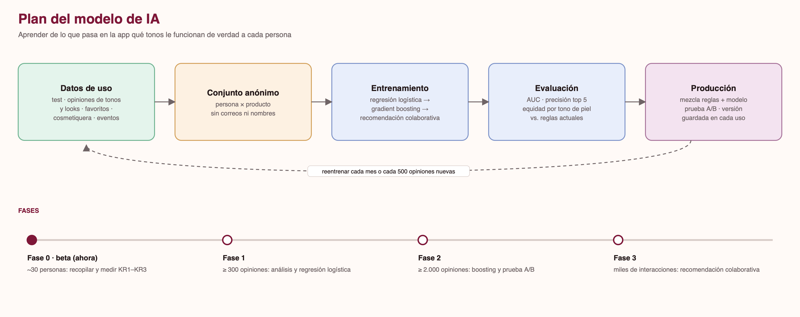

# Plan del modelo de IA

Hoy Chroma recomienda con **reglas**: el test se convierte en cuatro ejes de color (temperatura, profundidad, saturación y contraste), se elige la estación más cercana y cada producto recibe una compatibilidad de 0 a 100 por subtono, profundidad, estación, tipo de piel, acabado y presupuesto. Las reglas sirven para empezar, pero no aprenden.

**Objetivo:** con la información que se genera al usar la app, entrenar un modelo que **aprenda qué tonos le funcionan de verdad a cada persona**, y usarlo para ordenar el catálogo, el traductor y los looks mejor que las reglas.



## 1. Qué va a predecir

| Modelo | Pregunta que responde | Etiqueta (lo que se aprende) | Se usa en |
|---|---|---|---|
| **A · Acierto del tono** (prioritario) | ¿Este tono le va a quedar bien a esta persona? | Opinión sobre el tono: acertado, parcial o incorrecto | Orden del catálogo, traductor, asesor |
| B · Agrado del look | ¿Le va a gustar y lo usaría? | Opinión del look: le gusta, lo usaría | Asesor por ocasión |
| C · Estación de color | ¿Cuál es su estación? | Estación confirmada por un análisis profesional (pregunta 24 del test) | Resultado del test |

Se empieza por el **modelo A**: es el que más datos recibe (una opinión por producto probado) y el que más afecta los indicadores KR1 y KR2.

## 2. Qué información se recopila

### Ya se guarda (Supabase)

| Tabla | Qué aporta al modelo |
|---|---|
| `colorimetry_results` | Las 27 respuestas del test y el análisis (ejes, estación, subtono): **cómo es la persona** |
| `catalog_products` | Color oficial (se convierte a CIELAB), subtono, profundidad, acabado, categoría, marca, precio: **cómo es el producto** |
| `tone_feedback` | **Etiqueta del modelo A:** acertado, parcial o incorrecto; motivo del fallo (muy claro, muy oscuro, muy rosado, muy amarillo, acabado); si lo probó o solo lo vio en pantalla; confianza antes y después |
| `look_feedback` | **Etiqueta del modelo B:** le gusta, lo usaría, comentario y los productos del look |
| `favorites` y `vanity` | Señales implícitas positivas: lo guardó o ya lo tiene |

### Falta recopilar (siguiente versión)

| Dato | Por qué sirve | Cómo recopilarlo |
|---|---|---|
| **Eventos de uso**: ver un producto, abrir la tienda, usar el traductor | Señal implícita mucho más abundante que las opiniones | Tabla `interaction_events` (usuaria, producto, tipo de evento, fecha) |
| **¿Lo compraste?** | Distingue el interés de la compra real | Pregunta corta en la ficha, días después de abrir la tienda |
| **Recomendación mostrada y su posición** | Para no confundir "no le gustó" con "nunca lo vio" | Guardar qué productos y en qué orden se mostraron |
| **Estación confirmada** por un profesional | Etiqueta del modelo C | Ya existe la pregunta 24; ofrecer corregir la estación en el perfil |
| **Versión del motor** usado en cada recomendación | Comparar reglas vs. modelo | Columna `engine`, que ya existe en `colorimetry_results` |

No se guardan fotos del rostro ni de la piel.

## 3. Cómo se arma el conjunto de datos

Una fila por **opinión sobre un tono** (persona × producto):

| Grupo | Variables |
|---|---|
| Persona | Respuestas del test (codificadas), ejes de color (temperatura, profundidad, saturación, contraste), estación, subtono, tipo de piel, acabado preferido, presupuesto |
| Producto | Color en CIELAB (L, a, b), subtono, profundidad, acabado, categoría, marca, precio, calidad del dato |
| Relación | Distancia entre la profundidad de la piel y la del tono, si coincide el subtono, ΔE00 frente a la paleta de la estación, compatibilidad actual (reglas) |
| Etiqueta | acertado = 1, incorrecto = 0; parcial = 0,5 (o se excluye al inicio) |
| Peso | "Lo probé" pesa más que "solo lo vi en pantalla" |

Consulta de exportación (anónima: sin correos ni nombres; la ejecuta una administradora o el servidor):

```sql
select f.tono_resultado, f.motivo_tono, f.forma_evaluacion, f.confidence_before, f.confidence_after,
       r.answers, r.analysis -> 'axes' as ejes, r.season, r.undertone,
       c.categoria, c.marca, c.color_hex, c.subtono, c.profundidad, c.acabado, c.precio_cop, c.calidad,
       md5(f.user_id::text) as persona   -- identificador anónimo, solo para separar por persona
from public.tone_feedback f
join public.catalog_products c on c.id = f.product_id
join lateral (select * from public.colorimetry_results r
              where r.user_id = f.user_id and r.created_at <= f.created_at
              order by r.created_at desc limit 1) r on true;
```

## 4. Cuántos datos hacen falta

| Fase | Datos | Qué se hace |
|---|---|---|
| **0 · Beta (ahora)** | ~30 personas | Recopilar. Medir KR1 a KR3 con el panel. Muy pocos datos para entrenar |
| **1** | ≥ 300 opiniones de ≥ 100 personas | Análisis exploratorio: ¿en qué falla la regla? (por subtono, profundidad, marca). **Regresión logística**, interpretable, comparada con las reglas |
| **2** | ≥ 2.000 opiniones | **Gradient boosting** (LightGBM o XGBoost). Prueba A/B: mitad de usuarias con reglas, mitad con modelo |
| **3** | Miles de interacciones | **Recomendación colaborativa** (factorización de matrices) con favoritos, cosmetiquera y eventos de uso |

## 5. Cómo se evalúa

- **Separación por persona:** las opiniones de una misma persona van todas al entrenamiento o todas a la prueba, para no inflar el resultado.
- **Métricas:** AUC (separar aciertos de fallos), precisión en los 5 primeros del catálogo, calibración (si dice 80 %, que acierte cerca del 80 %).
- **Línea base:** la compatibilidad actual por reglas. El modelo solo entra si la supera.
- **Equidad:** las métricas se revisan **por profundidad de piel y por subtono**. El catálogo tiene menos tonos muy oscuros, y el modelo no debe funcionar peor para esas personas.
- **Negocio:** que suba el KR1 (≥ 80 % de recomendaciones útiles) en la prueba A/B.

## 6. Cómo se pone en producción

1. Exportar el conjunto de datos anónimo desde Supabase (consulta de arriba).
2. Entrenar en un notebook o script (`ml/`), guardar el modelo (`joblib`) con su versión y sus métricas.
3. Cargar el modelo en la API. La compatibilidad final mezcla reglas y modelo: `final = (1 − w) · reglas + w · modelo`, con `w` creciendo a medida que el modelo demuestra que acierta más.
4. Guardar en cada recomendación qué versión la produjo, para comparar.
5. Reentrenar cada mes o cada 500 opiniones nuevas.

## 7. Privacidad

- Las personas aceptan en los términos que sus respuestas y opiniones se usen, de forma anónima, para mejorar las recomendaciones.
- El conjunto de entrenamiento no lleva correos ni nombres; la persona se identifica con un código anónimo.
- Al borrar una cuenta se borran sus datos (`on delete cascade`) y no entran al siguiente reentrenamiento.
- No se recopilan fotos del rostro ni datos de salud.
