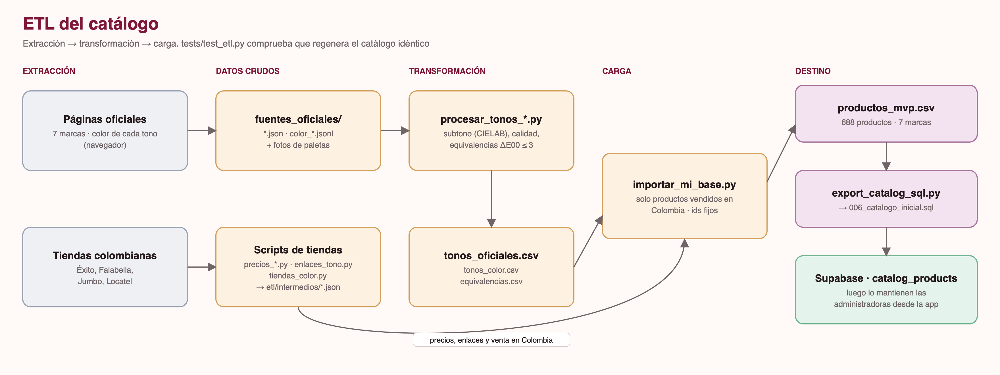

# ETL del catálogo

Scripts que construyeron el catálogo de Chroma (688 productos de 7 marcas, todos con el color oficial publicado por la marca). Se conservan para documentar de dónde sale cada dato y para poder regenerar o ampliar el catálogo.

> **Estado:** no se ejecutan en producción. El catálogo vive en Supabase (`catalog_products`) y desde la app lo mantienen las administradoras. Estos scripts se usan cuando hay que reconstruir el catálogo desde las fuentes o sumar marcas en lote.



## Etapas

| Etapa | Script | Entrada | Salida |
|---|---|---|---|
| **Extracción** · colores oficiales | (manual, con navegador) | Páginas oficiales de cada marca | `data/fuentes_mvp/fuentes_oficiales/*.json` y `color_*.jsonl` |
| **Extracción** · precio y foto | `precios_falabella.py` | Fuentes oficiales | `etl/intermedios/precios_falabella.json`, fotos |
| **Extracción** · precio y foto (Éxito) | `precios_exito.py` | Productos sin precio verificado | Actualiza `precios_falabella.json` |
| **Extracción** · enlace al tono exacto | `enlaces_tono.py` | `tonos_oficiales.csv` | `etl/intermedios/enlaces_tono.json` |
| **Extracción** · venta en Colombia (color) | `tiendas_color.py` | `color_*.jsonl` | `etl/intermedios/tiendas_color.json`, fotos |
| **Transformación** · bases y correctores | `procesar_tonos_oficiales.py` | Fuentes oficiales | `data/fuentes_mvp/tonos_oficiales.csv`, `etl/intermedios/equivalencias.csv` |
| **Transformación** · labiales, rubores, sombras | `procesar_tonos_color.py` | `color_*.jsonl` | `data/fuentes_mvp/tonos_color.csv` |
| **Carga** · catálogo | `importar_mi_base.py` | Todo lo anterior | `data/productos_mvp.csv` |
| **Carga** · base de datos | `../scripts/export_catalog_sql.py` | `productos_mvp.csv` | `supabase/migrations/006_catalogo_inicial.sql` |

Los colores se tomaron con el navegador, abriendo cada página de producto: el color lo carga JavaScript y los sitios no lo entregan a descargas automáticas. Cada tono guarda su página de origen y la fecha.

## Cómo ejecutarlo

Desde la carpeta `Chroma-Backend`:

```bash
# Solo transformación y carga (sin internet): regenera el catálogo desde las fuentes guardadas
python etl/procesar_tonos_oficiales.py
python etl/procesar_tonos_color.py
python etl/importar_mi_base.py
python scripts/export_catalog_sql.py
python scripts/audit_catalog.py
```

Las etapas de extracción en tiendas (`precios_*.py`, `enlaces_tono.py`, `tiendas_color.py`) consultan Éxito, Falabella, Jumbo y Locatel por internet. Sus resultados ya están guardados en `etl/intermedios/`; solo hace falta volver a correrlas para actualizar precios o sumar productos. Pueden dejar de funcionar si una tienda cambia su sitio. Las fotos que descargan quedan en `etl/fotos_productos/` (no se suben a Git) y se copian a `Chroma-App/public/static/img/products/oficial/`.

## Reglas de calidad

- **Solo colores oficiales** publicados por la marca (nivel B). En 4 paletas la marca no publica el color de cada sombra; ese color se tomó de la foto oficial (`origen_color = foto`; fotos en `data/fuentes_mvp/fotos_paletas/`).
- **Subtono:** el que declara la marca en el código del tono (Clinique WN/CN, L'Oréal True Match N/W/D). Si no lo declara, se calcula con el ángulo de tono en CIELAB.
- **Control de calidad** (`calidad`): `ambiguo` (dos tonos con el mismo color exacto), `incoherente` (el nombre dice profundo y el color es claro, o al revés) y `transparente` (brillos sin color). Esos tonos no entran al traductor.
- **Equivalencias:** misma categoría, otra marca, mismo subtono y ΔE00 ≤ 3.
- **Ids fijos** (`etl/intermedios/ids_color.json`): al sumar productos, los ids existentes no cambian, para que favoritos y opiniones sigan apuntando al producto correcto.
- **Venta en Colombia:** solo entran productos encontrados en tiendas colombianas; los demás se quedan en las fuentes, pero no se recomiendan.

## Reproducibilidad

`tests/test_etl.py` corre la transformación y la carga en una copia temporal del repositorio y comprueba que el resultado sea **idéntico, byte a byte**, al catálogo y a los archivos procesados del repositorio. Corre con el resto de las pruebas (`python -m pytest`).

## Próximo paso: datos para el modelo de IA

El catálogo es la base del modelo que se quiere entrenar con el uso de la app. Ver [docs/PLAN_MODELO_IA.md](../docs/PLAN_MODELO_IA.md).
